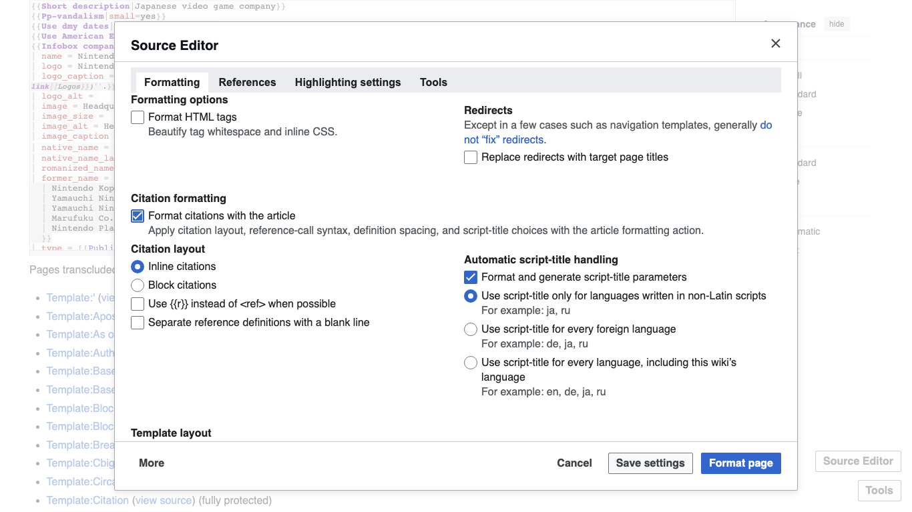
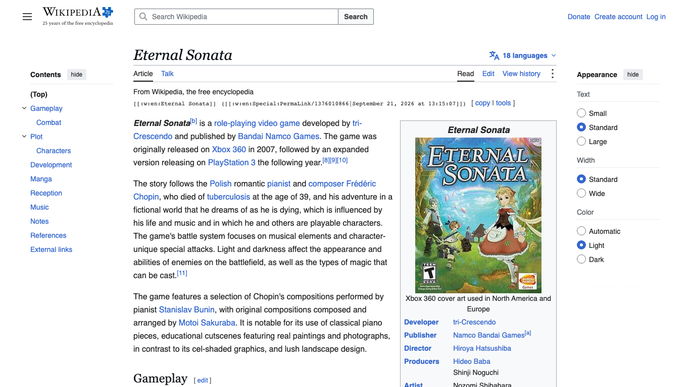
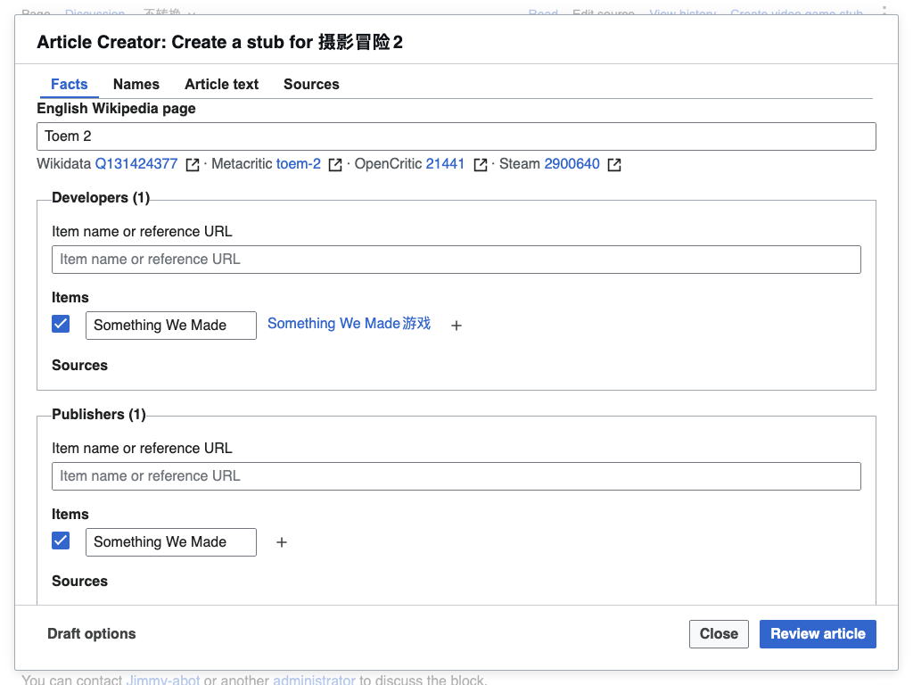
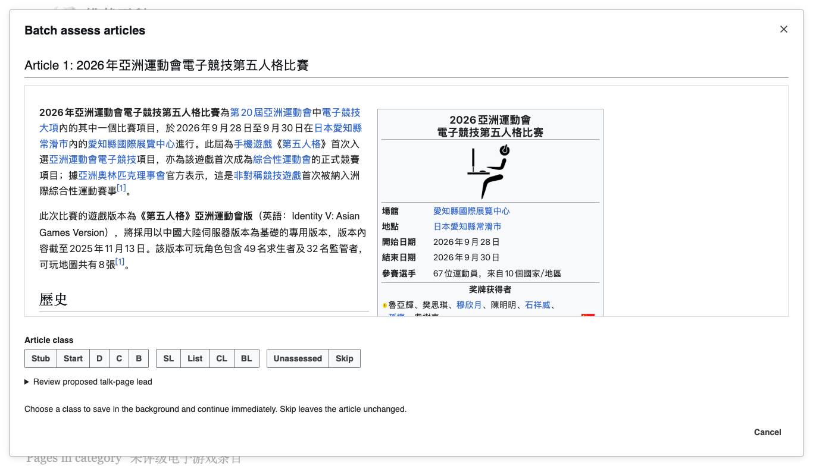

# Kanade

Kanade provides four independently installable tools for writing and maintaining
wiki articles: **Source Editor**, **Revision Copy**, **Article Creator**, and
**Article Assessor**. Install the tools you need; each opens in its supported wiki
and page context. Source, dependencies, verification, and versioning share one root.

**Last reviewed:** 2026-10-24. **Status:** development at version 0.1.1.
Source and tagged release automation are hosted in the [project repository][repository].
[Maintenance](docs/maintenance.md) records release readiness and ownership gaps.
See the [changelog](CHANGELOG.md) for version 0.1.1 release notes.

Start with [installation](#install-and-use), [configuration and data](#configuration-and-data),
or [contributing](CONTRIBUTING.md). The [maintenance guide](docs/maintenance.md)
records project ownership, external dependencies, recovery, and release readiness.

## Tools

Build from this checkout, then use the installation scripts linked below in
`dist/`. Tagged builds are published to [GitHub releases][releases] after verification.

| Distribution                                      | Purpose                                                    | Userscript manager                                      | Wiki script                                           |
| ------------------------------------------------- | ---------------------------------------------------------- | ------------------------------------------------------- | ----------------------------------------------------- |
| [Source Editor](docs/source-editor/README.md)     | Edit, highlight, format, and manage references.            | [source_editor.user.js](dist/source_editor.user.js)     | [source_editor.min.js](dist/source_editor.min.js)     |
| [Revision Copy](docs/rev-copy/README.md)          | Copy page, revision, section, and attribution wikitext.    | [rev_copy.user.js](dist/rev_copy.user.js)               | [rev_copy.min.js](dist/rev_copy.min.js)               |
| [Article Creator](docs/vg-stub-creator/README.md) | Prepare Chinese Wikipedia video-game articles.             | [vg_stub_creator.user.js](dist/vg_stub_creator.user.js) | [vg_stub_creator.min.js](dist/vg_stub_creator.min.js) |
| [Article Assessor](docs/wpvg-assessor/README.md)  | Assess and maintain Chinese Wikipedia video-game articles. | [wpvg_assessor.user.js](dist/wpvg_assessor.user.js)     | [wpvg_assessor.min.js](dist/wpvg_assessor.min.js)     |

### Source Editor

Open **Edit source** for live highlighting, link previews, and citation inspection.
The **Source Editor** panel combines formatting, reference management, and highlighting
settings. Create or reuse references, review proposed source, and publish through
[MediaWiki][mediawiki]. Accepted changes stay in the same editor and undo history until you publish.

Buttons in the bottom-right corner provide Source Editor actions available on
the current page. Revision Copy uses its inline toolbar and section popups.
Article Creator and Article Assessor open from page tools.
In a native source editor, **Tools** opens the regex replacer. Enter a pattern,
replacement, and flags; preview the changes before choosing **Apply replacements**.
An active selection limits the operation to that range. Otherwise it uses the
current source. The panel also offers **Undo replacement** for its last change.

[](docs/source-editor/images/screenshot01.en.png)

Screenshot article: [Nintendo, revision 1379167316][nintendo-revision], by
[English Wikipedia contributors][nintendo-history], under [CC BY-SA 4.0][article-license].
See the [Source Editor guide](docs/source-editor/README.md) and
[capture inventory](docs/source-editor/images/README.md) for the other views and provenance.

### Revision Copy

Copy page, exact-revision, and section links from the row above an article or a
heading's section menu. **Advanced copy** prepares translation and copying attribution
for edit summaries or talk pages. Review the generated text and copy it manually;
these actions do not submit wiki edits.

[](docs/rev-copy/images/screenshot01.en.png)

Screenshot article: [Eternal Sonata, revision 1376010866][english-sonata-revision], by
[English Wikipedia contributors][english-sonata-history], under [CC BY-SA 4.0][article-license].
Article imagery retains the file-page terms linked in the
[capture inventory](docs/rev-copy/images/README.md).
See the [Revision Copy guide](docs/rev-copy/README.md) for copy modes and attribution.

### Article Creator

Prepare Chinese Wikipedia video-game articles from names, game facts, and sources.
Review generated wikitext, previews, redirects, and related page operations before
saving. Form history restores unfinished drafts. Supplied facts still need reliable
sources and editorial judgment.

[](docs/vg-stub-creator/images/screenshot01.en.png)

The form shows illustrative Toem 2 input supplied by the user. Its host is
[Eternal Sonata, revision 94743103][sonata-revision], by
[Wikipedia contributors][sonata-history], under [CC BY-SA 4.0][article-license].
See the [Article Creator guide](docs/vg-stub-creator/README.md) and
[capture inventory](docs/vg-stub-creator/images/README.md) for input and source provenance.

### Article Assessor

Review Chinese Wikipedia video-game assessments, eligible new-page registrations,
and archive changes before saving. Category assessment offers article previews;
**choosing a class there saves immediately**. Quality and importance remain editorial
decisions.

[](docs/wpvg-assessor/images/screenshot01.en.png)

Screenshot source: [Category:未评级电子游戏条目, revision 80842948][assessor-category-revision], by
[Chinese Wikipedia contributors][assessor-category-history], under [CC BY-SA 4.0][article-license].
The capture inventory records the live category preview and image provenance:
[capture inventory](docs/wpvg-assessor/images/README.md).
See the [Article Assessor guide](docs/wpvg-assessor/README.md) for review and save behavior.

## Install and use

Use a browser with JavaScript enabled on a supported wiki. The host provides
MediaWiki and its required runtime modules; Node.js and npm are needed only when
building from source. Installing in `common.js` requires permission to edit your
personal JavaScript page. Article Creator and Article Assessor use your current
wiki session and require permission to edit each target page. Allow
browser clipboard access when Revision Copy requests it.

Download each tool you want from the table, or build from this checkout with the
commands below. Then use one installation method per tool:

- **Userscript manager:** open the raw `.user.js` file in [Tampermonkey][tampermonkey] or another
  compatible manager and install it.
- **Personal wiki script:** paste the complete `.min.js` file into
  `Special:MyPage/common.js` on a supported wiki, save, and reload.
- **Temporary session:** where the tool's guide supports it, paste the compact
  script into the browser console ([F12][developer-tools], then **Console**).
  It remains loaded until the next reload.

Source Editor and Revision Copy work on supported [Wikimedia sites][wikimedia-projects]. Article
Creator's full creation workflow and Article Assessor run on Chinese Wikipedia;
an English Wikipedia article can also launch Article Creator. All four tools
provide English, Simplified Chinese, Traditional Chinese, Japanese, and Russian
interfaces. Interface language is independent of a tool's wiki scope.

Each tool starts only in its supported context and mounts once. Preserve the
included license notices. When replacing an earlier installation, copy or export
unsaved work, disable the prior script, install the replacement, and reload. A
new startup guard cannot control an already loaded prior script. Uninstall by disabling the userscript
or removing its code from `common.js`, then reload. Tool guides explain where to
open each interface and its review, save, settings, and recovery behavior.

## Configuration and data

The scripts run in the wiki page context with userscript metadata `@grant none`.
Wiki writes use your existing account permissions. Network lookups read wiki APIs
and the metadata services described in each tool's guide; failed optional lookups
preserve the editor or draft for review.

| Tool             | Configuration and retained data                                                                                                                                                                                                               |
| ---------------- | --------------------------------------------------------------------------------------------------------------------------------------------------------------------------------------------------------------------------------------------- |
| Source Editor    | [Configuration](docs/source-editor/configuration.md): saved editor and formatting preferences, site metadata, and citation TemplateData caches in browser local storage; source text and citation drafts are not saved as settings.           |
| Revision Copy    | [Configuration](docs/rev-copy/configuration.md): pre-load options and page/revision lookup caches held in memory until reload.                                                                                                                |
| Article Creator  | [Configuration](docs/vg-stub-creator/configuration.md): browser-local form history and drafts, with tab-scoped checkpoints for unfinished operations. Its History dialog can import, export, and delete entries.                              |
| Article Assessor | [Review and recovery](docs/wpvg-assessor/review-workflow.md): staged drafts persist in local storage per wiki and account; read snapshots remain in the current tab's session storage, and public creation dates are cached in local storage. |

Browser storage belongs to the wiki origin and browser profile; it does not
synchronize across wikis or devices. Disabling a script does not erase saved
preferences or drafts. The [maintenance guide](docs/maintenance.md) describes data
handling and recovery; the linked tool guides explain their reset, deletion, and
unfinished-save behavior.

## Project schema

Source, tests, and guides use the tool directories `source-editor`, `rev-copy`,
`vg-stub-creator`, and `wpvg-assessor`. Dependencies, versioning, Git, and
installation artifacts stay at the root. Common capabilities live in `src/library/`
and are bundled into each tool that uses them.

```text
./
├── package.json / package-lock.json  # Shared version, dependencies, and commands
├── CHANGELOG.md                     # Project release notes
├── src/<tool>/                      # App, domain, platform, and features
├── src/library/                     # Library shared by the individual tools
├── tests/<tool>/                    # Offline unit, service, and browser fixtures
├── tests/library/                   # Shared library ownership and lifecycle tests
├── docs/<tool>/                     # User guides, internals, images, and provenance
├── scripts/                         # Build, checks, and maintenance helpers
├── dist/                            # Four independently installable script pairs
└── .github/workflows/               # Verification and tagged releases
```

[Architecture](docs/architecture.md) defines ownership and startup boundaries.
MediaWiki supplies [Vue][vue] and [Wikimedia Codex][codex] at runtime. Each
script contains its own entrypoint and the launcher registration code it needs.

## Develop

Use Node.js `^24.15.0 || >=26.0.0` and npm 11 or newer. Run commands from the
repository root:

```sh
npm ci
npm run build
npx playwright install chromium
npm run verify
```

[Development](docs/development.md) owns setup, coding, verification, and releases.
Read [UI guidelines](docs/ui-guidelines.md) for interaction policy and
[documentation](docs/documentation.md) for writing and screenshot requirements.
[CONTRIBUTING.md](CONTRIBUTING.md) links the contributor entrypoints. Tool
architecture guides record notable behavior changes and their verification.

## License and credit

Project-owned code and documentation use [CC0-1.0](LICENSE).
Source Editor builds on [Cacycle's wikEd](https://en.wikipedia.org/wiki/User:Cacycle/wikEd).
Third-party code, icons, article text, data, and screenshots retain their own
terms. See [third-party notices](THIRD-PARTY-NOTICES.md) and each tool's
screenshot provenance.

[developer-tools]: https://en.wikipedia.org/wiki/Web_development_tools
[article-license]: https://creativecommons.org/licenses/by-sa/4.0/
[nintendo-revision]: https://en.wikipedia.org/w/index.php?title=Nintendo&oldid=1379167316
[nintendo-history]: https://en.wikipedia.org/w/index.php?title=Nintendo&action=history
[sonata-revision]: https://zh.wikipedia.org/w/index.php?title=%E4%BF%A1%E8%B3%B4%E9%88%B4%E9%9F%B3_%EF%BD%9E%E8%95%AD%E9%82%A6%E4%B9%8B%E5%A4%A2%EF%BD%9E&oldid=94743103
[sonata-history]: https://zh.wikipedia.org/w/index.php?title=%E4%BF%A1%E8%B3%B4%E9%88%B4%E9%9F%B3_%EF%BD%9E%E8%95%AD%E9%82%A6%E4%B9%8B%E5%A4%A2%EF%BD%9E&action=history
[english-sonata-revision]: https://en.wikipedia.org/w/index.php?title=Eternal_Sonata&oldid=1376010866
[english-sonata-history]: https://en.wikipedia.org/w/index.php?title=Eternal_Sonata&action=history
[assessor-category-revision]: https://zh.wikipedia.org/w/index.php?title=Category%3A%E6%9C%AA%E8%AF%84%E7%BA%A7%E7%94%B5%E5%AD%90%E6%B8%B8%E6%88%8F%E6%9D%A1%E7%9B%AE&oldid=80842948
[assessor-category-history]: https://zh.wikipedia.org/w/index.php?title=Category%3A%E6%9C%AA%E8%AF%84%E7%BA%A7%E7%94%B5%E5%AD%90%E6%B8%B8%E6%88%8F%E6%9D%A1%E7%9B%AE&action=history
[mediawiki]: https://www.mediawiki.org/wiki/MediaWiki
[tampermonkey]: https://www.tampermonkey.net/documentation.php
[wikimedia-projects]: https://meta.wikimedia.org/wiki/Wikimedia_projects
[vue]: https://vuejs.org/guide/introduction.html
[codex]: https://doc.wikimedia.org/codex/latest/
[repository]: https://github.com/For-Each-Next/Kanade
[releases]: https://github.com/For-Each-Next/Kanade/releases
