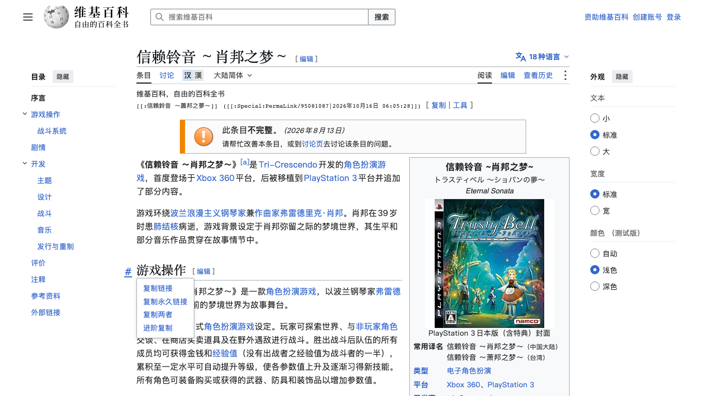
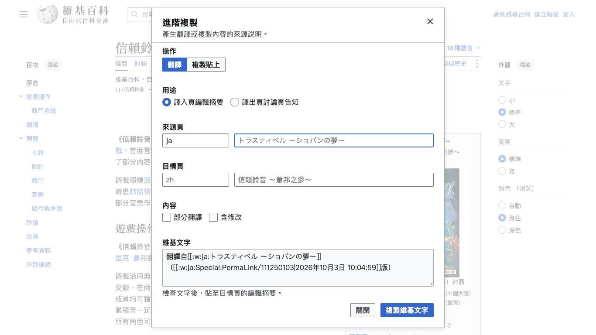

# Revision Copy

Last reviewed: 2026-10-21.

Revision Copy adds a small copy toolbar above Wikimedia pages. It prepares wikitext for
page links, exact revisions, sections, and translation or copy attribution. It
reads page information and copies text without publishing wiki edits.

## Features

- Copy a page link with the displayed revision's permanent link.
- Copy section links and revision comparisons on diff views.
- Prepare translation or copy-and-paste attribution for summaries and talk pages.
- Use Wikimedia cross-wiki links and source-language revision timestamps.
- Use English, Simplified Chinese, Traditional Chinese, Japanese, or Russian labels.

## Install and open

Install [rev_copy.user.js](../../dist/rev_copy.user.js) in a userscript manager, or
paste [rev_copy.min.js](../../dist/rev_copy.min.js) into your wiki's
`Special:MyPage/common.js`. You can also paste the compact script into the browser
console for the current page visit. Reload after installation; the toolbar
appears above page content. Remove the userscript or its `common.js` code to
uninstall it.

Open Advanced copy from the row's **Tools** action or a section's copy popup.
Revision Copy adds no floating bottom-right button.

See the [project installation guide](../../README.md#install-and-use) for shared
build and installation methods.

## Use

**Copy** copies page and available revision wikitext together. **Tools** prepares
attribution text to review and copy. Click an individual wikitext link, or focus
it and press Enter/Space, to select its text for native copying.

The toolbar appears with its complete text once the revision date is available.
Pages without a revision show the page link immediately; a failed date lookup
also leaves a page-only toolbar.

The `#` control beside a page or section heading copies its section link. Hover,
focus, or press ArrowDown to open the section menu. **Advanced copy** opens the
attribution dialog with that section selected. The dialog's **Partial** option
describes reusing only part of the selected source.

If a revision link is unavailable, the row keeps the page link and normal
actions. Clipboard success appears only after the copy completes. Allow browser
clipboard access when needed.

| English page and exact-revision row                                | Simplified Chinese section menu                                     | Traditional Chinese attribution dialog                                     |
| ------------------------------------------------------------------ | ------------------------------------------------------------------- | -------------------------------------------------------------------------- |
|  |  |  |

These captures show actual English and Chinese Wikipedia pages. The
[image inventory](images/README.md) records each image's source revision,
contributors, capture conditions, and the article's separately licensed cover
and game imagery. The project's CC0 dedication covers its own interface, not
captured article or media content.

## Reference

- [Project maintenance](../maintenance.md) for status, contact, dependencies,
  browser data, recovery, and handoff.
- [Usage and configuration](configuration.md).
- [Architecture](architecture.md) and [interface details](ui-guidelines.md).
- [Development](../development.md) and [documentation](../documentation.md).
- [CC0-1.0 license](../../LICENSE); captured Wikimedia content retains its own terms.
