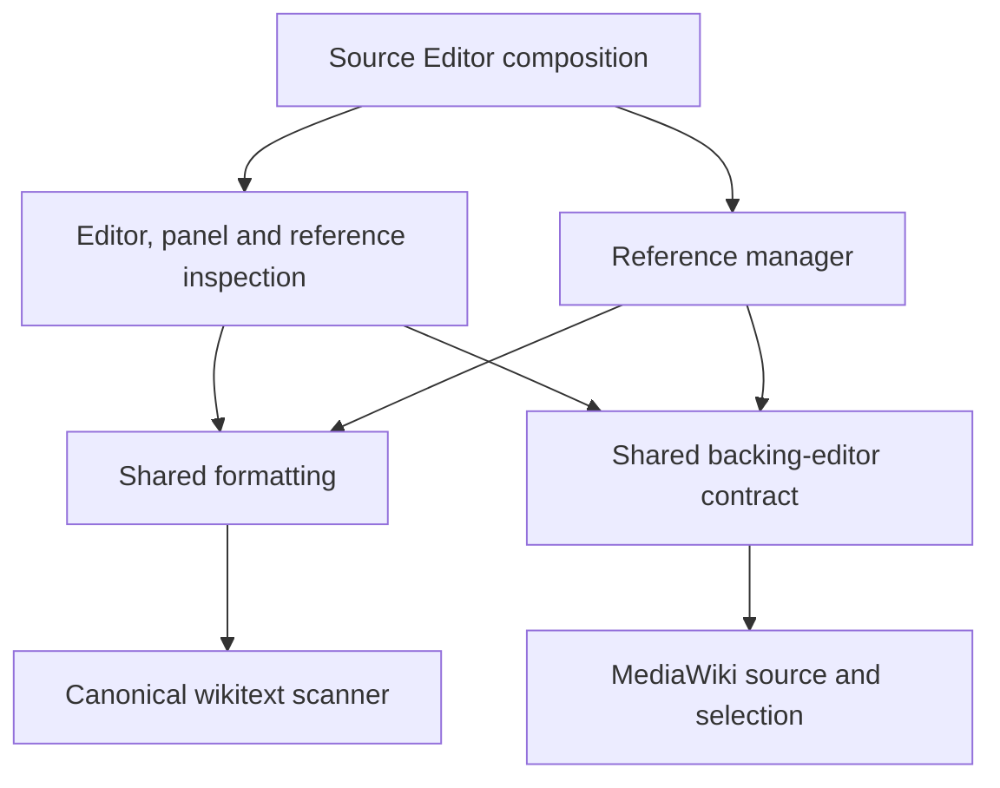

# Source Editor architecture

Last reviewed: 2026-10-21.

Source Editor is one source-editing tool with highlighting, formatting, citation
creation, and reference management. One composition root owns startup and the
page-tools launcher. Its panel opens the reference manager; reference-inspection
popups share the same backing editor and source rules without another manager
launcher.

## Ownership

| Location                      | Responsibility                                                                              |
| ----------------------------- | ------------------------------------------------------------------------------------------- |
| `src/source-editor/app/`      | Browser startup, editor setup, services, contracts, and reference workflows.                |
| `src/source-editor/domain/`   | Highlighting, formatting, citation models, naming, and validation using the shared scanner. |
| `src/source-editor/platform/` | Backing-editor access, MediaWiki, browser storage, and remote-service adapters.             |
| `src/source-editor/features/` | Enhanced editor, previews, formatter panel, and reference-manager interfaces.               |
| `src/source-editor/i18n/`     | English, Chinese, Japanese, and Russian catalogs with one interface-language runtime.       |
| `src/source-editor/config/`   | Generated citation TemplateData with English-first ordering.                                |
| `src/source-editor/types/`    | Ambient host and build declarations.                                                        |
| `tests/source-editor/`        | Offline unit, service, and browser tests with attributed fixtures.                          |
| `scripts/source-editor/`      | Citation TemplateData maintenance and live browser capture helpers.                         |
| `docs/source-editor/`         | One tool guide, topic references, architecture, and image inventory.                        |

Organize source by these shared roles. Give each feature and deterministic rule
a named owner within them; editor and citation work do not create separate tool
trees. Use lowercase kebab-case for authored modules, reserve `index.ts` for an
intentional public boundary, and keep domain-specific rules out of generic
utility folders. Dependencies, checks, versioning, and distribution belong to
the root project; see [development](../development.md).

## Composition and dependencies

`src/source-editor/app/browser.ts` is the browser entrypoint. The application creates
platform adapters and injects their contracts into editor services and the
source-manager controller. `app/main.ts` owns startup, editor setup, and the
shared logger, notifications, and interface locale. Its reference-management
factory receives those services and assembles the manager without another
launcher or browser entrypoint.

Startup is guarded by `Symbol.for('kanade.source-editor.startup')`. Composition
validates `window.sourceEditorConfig` once, freezes the resolved options, and
injects them with the target-wiki policy. Features do not read runtime configuration
globals or import concrete platform adapters. The backing-editor and notification
ports belong to consumer contracts, independent of their host implementations.
The [shared dependency matrix](../architecture.md#dependency-direction) applies
to every Source Editor module.

`domain/runtime-options.ts` owns the pure `SourceEditorOptions` model and
`resolveSourceEditorOptions` validation. Invalid fields use their own defaults;
delays are integers from 0 through 60,000 milliseconds and the source-length limit
accepts a nonnegative safe integer or `Infinity`. Changing the pre-load object
after startup requires a reload.

Formatter component registration lives in `features/formatter/codex.ts`;
reference-manager component selection remains local to that feature. Matching
ResourceLoader loading and Vue interfaces come from
`src/library/mediawiki-runtime/`. Action notifications use
`src/library/notifications/` with Source Editor messages and tags supplied locally.
Catalog translation and locale fallback use `src/library/i18n/messages.ts`;
Source Editor retains its catalogs and startup-owned interface locale.
Structured logging and raw Citoid transport use `src/library/logging/` and
`src/library/citoid/`; source-metadata normalization and request ownership stay
with Source Editor. Object-shape validation uses `src/library/data-validation/`
without relaxing adapter-specific schemas.
`app/formatter.ts` composes dialog presentation with editor services and native
input delivery. The source-manager consumer receives immutable wiki context and
an injected module loader; neither feature chooses a concrete platform adapter.

Dependencies point toward contracts and deterministic rules. Domain and shared
modules do not depend on UI state, MediaWiki globals, network adapters, or
startup. Consumer contracts belong with application or domain owners; features
consume injected services and pure operations. Platform implementations satisfy
those contracts. Tests replace external operations with offline fixtures.

`src/source-editor/index.ts` exports pure editor, citation, scanner, and formatting APIs
without starting the browser. The canonical scanner under `src/library/wikitext/`
supplies common boundaries for comments, opaque extension content, nested
templates, and reference attributes. `formatArticleSource` in
`domain/formatting.ts` composes source and citation formatting. The main
Formatting tab owns the complete operation and its settings; reference-manager
Tools returns to this panel rather than maintaining another formatting form.
`domain/citation-formatter.ts` owns citation-specific transformation rules.
Reference composition shares template namespace and TemplateData loading with
the formatter, and the formatter checks that source and selection still match
after metadata and redirect lookups before accepting a transformation.

The same pure scanner parses Creator's editable citation templates. Shared
source-range operations merge and mask scanner intervals, apply edits against
original offsets, and project tag markup without re-parsing tag contents.
Highlighting retains its own non-empty-interval and literal-tag policies. Source
Editor keeps its public `wikitext` export while importing the library directly;
the shared scanner's regression suite lives in `tests/library/`. The extraction
does not change editor source offsets, formatting policy, or lifecycle ownership.

The sole page-menu entry uses `mw.util.addPortletLink` and preserves the host
skin's markup, layout, and styles. Dialogs load the wiki's Vue and
[Wikimedia Codex][codex] through ResourceLoader when needed. npm packages provide
development types and browser fixtures; production does not bundle another
framework runtime.

Source Editor registers its bottom-right Format and Tools actions through
`src/library/quick-access/registry.ts`, the launcher owner. The other three tools
use their inline, section, or native page-tool entries. The library owns rendering
and registration disposal; Source Editor keeps
its editor, dialog, request, and source-mutation lifecycles. The Source Editor
bundle includes this library code without starting any other tool. Shared launcher
regressions live in `tests/library/quick-access.test.mjs`.

Format applies the current selection, or the complete section/page when no
text is selected, in one explicit click. It shares accepted session settings,
validated saved defaults, transformations, notifications, and the controller's
undo path with the panel. The page-tools Source Editor link still opens that panel
for settings and reference management. Direct formatting ignores duplicate pending
clicks and never accepts an open panel's unsaved draft. Before applying asynchronous
results, it checks source, selection, page, textarea, and controller identity;
input, composition, and navigation invalidate pending work. Its transient listeners
are released on completion. This adds no persistence or wiki-save path.
AI assistance covered the direct action, shared layout, and regression tests;
offline tests exercise accepted settings, stale-result rejection, and source undo.

## Editor synchronization and lifecycle

Editor integration discovers eligible native textareas. Source Editor enhances wikitext
and can delegate other content models to CodeMirror when the user enables that
setting. The editor controller owns synchronization, history, and lifecycle;
surface, DOM, and rendering modules own browser mechanics. Optional
contributions own missing-link checks and hover previews. The formatter feature
owns its dialog and accepted operations.

The pure syntax engine and token palette live in
`src/library/wikitext-highlighting/`. Source Editor keeps its existing public
`highlightWikitext` export and full editor lifecycle. Gadgets that only need
syntax colors use the separate native-textarea attachment in
`src/library/wikitext-textbox/`, described in the
[shared architecture](../architecture.md#syntax-only-gadget-textboxes); they do
not acquire Source Editor's previews, link checks, toolbar, or reference manager.

The submitted textarea owns source text and selection. Article input immediately
mirrors text and the valid article selection into it; selection changes and blur
also update its range. Highlighting renders from the native text and restores
the native range. Tooltip or dialog focus preserves that range so an unrelated
DOM selection cannot move an accepted source edit. External native input renders
immediately. Backend writes update the textarea before rendering the highlighted
layer and recording undo history.

A scheduled background redraw first captures the focused editor's live selection
when its DOM text still matches the native source. This protects Select All and
other fresh ranges while the browser's selection-change event is pending.
Immediate native, tool, and history replacements keep their requested native
range. Browser regressions hold selection events across a metadata redraw in
both highlighting and plain-source fallback modes, then check replacement and undo.

One editable-DOM reader normalizes source text and selection offsets, ignoring browser-only caret
placeholders and preserving line boundaries. A trailing source newline renders
with a final editable-line sentinel; highlighting and plain fallback redraws keep
the editor's scroll offsets. Browser regressions cover consecutive blank lines, continued
template typing, long-source fallback, scrolling, and undo/redo. These mechanics preserve the backing textarea as the source owner.

Removing an enhanced surface restores the textarea and releases its owned
listeners, timers, observers, and optional contributions. Asynchronous lookups
discard results after source, settings, cache, or lifecycle identity changes.
Formatting protects opaque source ranges. Article content, translated messages,
and service responses render as text.

When native CodeMirror has been disabled through its toolbar, its hidden wrapper
can still apply a rule that displays the textarea. Source Editor's owned hiding
selector takes precedence while its enhanced surface is attached, preventing a
second visible copy of the source. Removing the owned class restores native host
display behavior; source, selection, and read-only state stay with the textarea.
An offline browser regression covers both visibility states against the host
wrapper rule.

## Reference inspection and previews

`features/editor/reference-tooltip.ts` owns reference-preview UI, hover
lifecycle, positioning, forms, icons, theme, and displayed values. Keep its
private helpers with that owner. Article and reference previews share frame-safe
positioning and hovered-line selection in `features/editor/preview-position.ts`.

`domain/reference-preview.ts` owns preview models and source-edit validation.
`domain/reference-changes.ts` tracks saved changes and resets, while
`src/library/wikitext-highlighting/reference-highlighting.ts` supplies reference-specific highlight ranges
to the main highlighter. These rules remain independent of tooltip DOM and
editor state. Inspecting a reference and opening the full manager use the same
source and editing contract.

The reference popup keeps its inline field/content editing controls but has no
Manage reference button. The full manager opens from the panel's References tab.
Removing the popup-only action also removes its selected-reference handoff and
unused labels; preview rendering, save/reset, source ownership, and undo remain
unchanged. AI assistance covered the removal and regression updates. Popup
browser tests assert the action is absent and retain editing/lifecycle coverage;
the three citation-inspection screenshots use the updated source.

## Reference-management sessions

`features/source-manager/` owns lookup, browsing, citation drafts, analysis, and
recovery. Its controller and state modules own session behavior, and
`dialogs.ts` assembles the dialog surfaces. Each dialog has a co-located
template-only `.vue` file, a TypeScript context and build bundle, and a scoped
stylesheet. The build injects templates and styles into self-contained
installation files.

Codex controls retain their default appearance and follow the host theme.
Additional interface CSS arranges columns and responsive layout. Fields own
validation, messages own status and warnings, and dialogs share neutral
cancellation and footer behavior. The citation draft's Cancel control is a quiet
neutral button; Apply and keep editing remains a normal secondary action before the
primary Save citation action. These native Codex attributes apply in every
interface language. The manager tracks its narrow-screen media
query so keyed actions keep their visual and keyboard order. Horizontal groups
finish with the primary action; stacked groups begin with it. Disposal releases
the media-query listener and mounted interface, including when setup fails.
Pending article-preview reads are invalidated before releasing a disposed
editor, so they cannot update its highlighting afterward.

The reference manager, citation editor, checks, and formatter use an owned
desktop maximum width of 64rem. Their selectors retain that width when the host
loads Codex styles later; Codex still bounds the dialog to the viewport. Citation
parameter names, values, and actions share columns when their containing editor
has at least 42rem available and stack in the same reading order below that
width. Container queries also handle a narrow editor inside a wide window.
Columns respect Codex's native control minimum widths. Separate layout wrappers
around each Field keep adjacent-field spacing from offsetting the value column
without overriding component appearance. Row actions wrap, original source scrolls
within its region, and bounded footer columns keep long translated actions
inside mobile dialogs. The layout adds no stored state or requests and retain explicit citation acceptance,
backing-source ownership, and undo behavior.

Offline Chromium regressions cover English and Russian at 375 × 667, 683 × 768,
880 × 768, and 1366 × 768, a separately narrowed 260px parameter editor, long
citations and URLs, late host styles, and accepted-source undo. Manual keyboard and screen-reader
release review remains pending; automated geometry checks do not establish that
review or accessibility conformance.

Pending lookups and stored drafts belong to their current session. Results must
still match that session, input, and source revision. Operations promising the
current article re-read it. Formatting retains unknown parameters and
unsupported syntax, protects literal tags and comments, and changes source only
after explicit acceptance. Review fixes record enough state to revert their own
changes; recovery protects later unrelated editing.

## Backing-editor contract

The main panel's Tools tab owns regex replacement review and recovery in
`features/formatter/regex-tools.ts`. It captures source and selection when opened,
keeps numbered Find/Replace drafts and previews in memory, and checks full source, page identity,
editor ownership, and editing availability before accepting results. Explicit
apply uses the same controller replacement path and history as formatting.
The initial two pairs can be extended or removed, with focus following the added
or remaining Find field. Empty unused pairs are skipped. The feature session
passes each active pair's output to the next worker and accepts the final result
only when every pair succeeds. One Apply and Undo cover the complete sequence.
The default visible form contains only numbered fields and collection actions;
shared JavaScript flags remain in a collapsed Options section. Long expression
and substitution reference text belongs in the control-panel guide.
An optional in-dialog undo restores only the last replacement when its full
result still matches the editor, protecting later unrelated edits. Closing
invalidates work and releases composition listeners; it does not publish source.

`domain/regex-replacement.ts` implements bounded JavaScript substitution rules,
including capture groups, named groups, context tokens, and Unicode empty-match
advancement. `platform/browser/regex-replacement.ts` serializes that self-contained
operation into a disposable Blob Web Worker and passes input through `postMessage`.
Composition injects this executor through `EditorServices`; UI state does not
choose a concrete host adapter. Each pair has a 1.5-second timeout and
2,000,000-code-unit input/output cap; the session bounds the complete sequence to
10,000 matches. Pattern and replacement inputs remain bounded per pair.
Draft changes, supersession, worker errors, timeout, and
dialog disposal terminate the worker and revoke its Blob URL. Unsupported workers
or a host content-security policy that blocks Blob workers produce an actionable
error while preserving the draft. No fallback executes patterns on the main
thread. This adds no dependency, storage record, request, or wiki-write path.

Unit tests compare replacement results with JavaScript string replacement,
exercise ordered pairs, atomic review, aggregate match limits and stale ownership, and verify cancellation and timeout
cleanup. Offline browser tests execute the actual worker, review a captured
selection, apply and undo it, reject later source changes, and recover after a
catastrophic expression times out. This implementation received substantial AI
assistance; manual keyboard and screen-reader release review remains pending.

`src/source-editor/app/contracts/editor-backend.ts` owns the consumer contract.
`src/source-editor/platform/editor-backend.ts` owns textarea-local registration.
The enhanced editor registers its backend at
`Symbol.for("mediawiki-gadgets.edit-box-backend")`. Reference and editor features
can read source, write accepted transformations, replace a selection, preserve
position, and focus the editor through that contract without touching another
surface's internal DOM.

The common native textarea, CodeMirror, and VisualEditor adapters live in
`src/library/mediawiki-edit-box/` and are also bundled by Article Creator.
They resolve the current host editor for each operation, retaining CodeMirror
toggle/destruction tracking and native input/change delivery. Source Editor
keeps its position-preserving writes and stricter enhanced-backend acceptance
in its platform adapter; the shared reader receives that acceptance rule.
Shared tests cover native selection edits, backend replacement, and CodeMirror
lifecycles. Source Editor tests retain selection, scroll, and owned-backend
disposal coverage. AI assistance covered this extraction and its verification.

MediaWiki adapters under `platform/mediawiki/edit-box/` consume the same
position-preserving operation supplied by composition. Accepted changes reach
the submitted textarea and undo history. The backend uses the native selection
when no valid article DOM selection exists, and restores that range when
focusing the enhanced surface. Mutations reject active IME composition and
disposed editors before changing text. Disposal unregisters the owned backend;
native input events remain supported.

## Wiki-specific content policy and metadata

Namespace decoding and title operations use `src/library/wiki-titles/`.
The `canonical.ts` policy keeps editor links conservative before live siteinfo
arrives: only the main, File, Template, and Category canonical names are known.
Citation templates use the existing English/Chinese Wikipedia aliases through
`wikipedia.ts`. Both policies prefer an explicitly supplied live catalog and
share one decoder and prefix parser in `catalog.ts`; a wiki's interface language
never selects its namespace rules. Shared regressions retain catalog validation,
alias provenance, title case, and the difference between these fallback policies.

Citation-formatting and editor preferences share one validated settings model.
The panel keeps a draft until the user accepts an action. Accepted settings are
held in memory for the edit session and initialize new reference tasks; opening
the manager passes the panel's citation choices directly. Save settings persists
the entire draft without applying settings to the active editor or formatting
source. Reset removes the saved record and restores draft defaults. Storage
failures retain the open draft and do not prevent session-only acceptance.

The browser store uses `kanade:source-editor:formatter-settings:v1` on the
current wiki origin. Saves contain `{ schemaVersion: 1, settings }`; only this
validated envelope is accepted. Missing, unsupported, or malformed records load
defaults. Retired preference records are not imported or deleted automatically. Source drafts,
reference text, and account information are not part of this preference record.

`domain/script-title-policy.ts` selects title handling from the target's content
language. Non-Latin and foreign-language modes retain local-language titles;
Always also permits the local language. `wgContentLanguage` is independent of
interface translation and wiki-specific date policy. When that value is absent,
verified English/Chinese wiki identity supplies its established fallback;
foreign-language decisions on unknown targets preserve input.

`domain/wiki-policy.ts` defines `WikiPolicy` and `resolveWikiPolicy(wikiId)`.
`platform/wiki-policy.ts` resolves the actual `wgWikiID` or `wgDBname`; interface
language never selects citation rules. The shared `citationDates.normalize`
strategy applies to article formatting and new or edited drafts.

The `enwiki` policy writes a month-only value such as `2026-07` as `July 2026`,
following [English Wikipedia's citation date guidance][enwiki-dates]. The
`zhwiki` policy can retain `2026-07` and normalize `July 2026` to that form,
consistent with its [date-validation module][zhwiki-dates]. These policies apply
to those projects; unknown projects preserve entered dates. Only supported
formats and precision are normalized. Year-only, year-quarter, unsupported
values, comments, and opaque source stay unchanged. Full-day values retain ISO
behavior, and month-only values never gain an invented day.

Supported citation templates use generated TemplateData under
`src/source-editor/config/citation-template-data/`. The updater completes the English parameter
order from English canonical parameters, then appends distinct Chinese order
entries. English aliases and date types take precedence; Chinese metadata is
the fallback when English data is unavailable. The snapshot domain module also
owns parameter-name and alias-array validation used by the runtime cache;
the TemplateData API adapter owns request batching. Generic Cite templates outside
that set use the host wiki's runtime cache. Local validators provide
conservative feedback; the live wiki's CS1 modules remain authoritative.
See [CS1 maintenance](cs1/maintenance.md) for generation and validation rules.

## Build and verification

The root build uses esbuild for ES2024 output and emits one Source Editor script pair
under `dist/`. The individually installable pair uses the unified editor and
reference-manager entrypoint.
Only selected Codex icon data and the HTML entity decoder from `entities` are
bundled from npm. The decoder keeps reference identities consistent without a
browser DOM. Generated artifacts preserve the applicable
[third-party notices](../../THIRD-PARTY-NOTICES.md).

Unit and service tests cover pure source operations, editor synchronization,
boundary validation, session identity, accepted transformations, and recovery.
Offline browser tests exercise actual dialogs and enhanced source behavior.
The [control-panel guide](control-panel.md) records the interaction contract and
UI verification; the [image inventory](images/README.md) records
live capture procedures, source revisions, and retained-fixture provenance. Follow the shared
[verification policy](../development.md#verification-and-delivery) for material
changes.

[codex]: https://doc.wikimedia.org/codex/latest/
[enwiki-dates]: https://en.wikipedia.org/wiki/Help:CS1_errors#bad_date
[zhwiki-dates]: https://zh.wikipedia.org/wiki/Module:Citation/CS1/Date_validation
