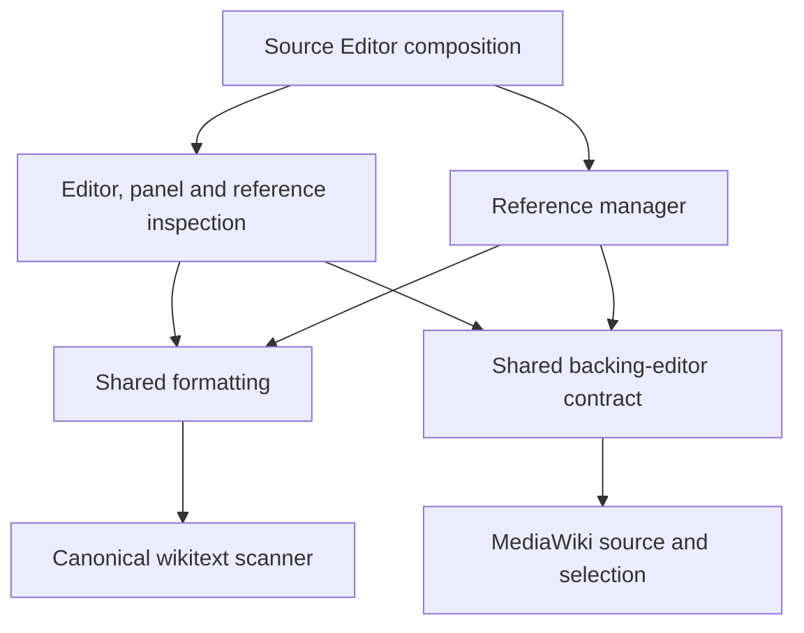

# Source Editor architecture

Last reviewed: 2026-11-14.

Source Editor provides formatting, citation creation, and reference management
through the active MediaWiki source editor. One composition root owns startup
and the page-tools launcher. MediaWiki CodeMirror owns highlighting and editor
preferences. Its enable/disable choice remains with MediaWiki.

## Ownership

| Location                      | Responsibility                                                                        |
| ----------------------------- | ------------------------------------------------------------------------------------- |
| `src/source-editor/app/`      | Browser startup, editor setup, services, contracts, and reference workflows.          |
| `src/source-editor/domain/`   | Formatting, citation models, naming, and validation using the shared scanner.         |
| `src/source-editor/platform/` | Backing-editor access, MediaWiki, browser storage, and remote-service adapters.       |
| `src/source-editor/features/` | Formatter panel and reference-manager interfaces.                                     |
| `src/source-editor/i18n/`     | English, Chinese, Japanese, and Russian catalogs with one interface-language runtime. |
| `src/source-editor/config/`   | Generated citation TemplateData with English-first ordering.                          |
| `src/source-editor/types/`    | Ambient host and build declarations.                                                  |
| `tests/source-editor/`        | Offline unit, service, and browser tests with attributed fixtures.                    |
| `scripts/source-editor/`      | Citation TemplateData maintenance and live browser capture helpers.                   |
| `docs/source-editor/`         | One tool guide, topic references, architecture, and image inventory.                  |

Organize source by these shared roles. Give each feature and deterministic rule
a named owner within them; editor and citation work do not create separate tool
trees. Use lowercase kebab-case for authored modules, reserve `index.ts` for an
intentional public boundary, and keep domain-specific rules out of generic
utility folders. Dependencies, checks, versioning, and distribution belong to
the root project; see [development](../development.md).

## Composition and dependencies

`src/source-editor/app/browser.ts` is the browser entrypoint. The application creates
platform adapters and injects their contracts into editor services and the
source-manager controller. `app/main.ts` owns startup, editor setup, and the
shared logger, notifications, and interface locale. Its reference-management
factory receives those services and assembles the manager without another
launcher or browser entrypoint.

Startup is guarded by `Symbol.for('kanade.source-editor.startup')`. Composition
validates `window.sourceEditorConfig` once, freezes the resolved options, and
injects them with the target-wiki policy. Features do not read runtime configuration
globals or import concrete platform adapters. The backing-editor and notification
ports belong to consumer contracts, independent of their host implementations.
The [shared dependency matrix](../architecture.md#dependency-direction) applies
to every Source Editor module.

`domain/runtime-options.ts` owns the pure `SourceEditorOptions` model and
`resolveSourceEditorOptions` validation. Invalid fields use their own defaults;
the remaining runtime option is the validated log level. Changing the pre-load
object after startup requires a reload. Removed custom-highlighting and hover
options have no effect.

Formatter component registration lives in `features/formatter/codex.ts`;
reference-manager component selection remains local to that feature. Matching
ResourceLoader loading and Vue interfaces come from
`src/library/mediawiki-runtime/`. Action notifications use
`src/library/notifications/` with Source Editor messages and tags supplied locally.
Catalog translation and locale fallback use `src/library/i18n/messages.ts`;
Source Editor retains its catalogs and startup-owned interface locale.
Structured logging and raw Citoid transport use `src/library/logging/` and
`src/library/citoid/`; source-metadata normalization and request ownership stay
with Source Editor. Object-shape validation uses `src/library/data-validation/`
without relaxing adapter-specific schemas.
`app/formatter.ts` composes dialog presentation with editor services and native
input delivery. The source-manager consumer receives immutable wiki context and
an injected module loader; neither feature chooses a concrete platform adapter.

Dependencies point toward contracts and deterministic rules. Domain and shared
modules do not depend on UI state, MediaWiki globals, network adapters, or
startup. Consumer contracts belong with application or domain owners; features
consume injected services and pure operations. Platform implementations satisfy
those contracts. Tests replace external operations with offline fixtures.

`src/source-editor/index.ts` exports pure editor, citation, scanner, and formatting APIs
without starting the browser. The canonical scanner under `src/library/wikitext/`
supplies common boundaries for comments, opaque extension content, nested
templates, and reference attributes. `formatArticleSource` in
`domain/formatting.ts` composes source and citation formatting. The main
Formatting tab owns the complete operation and its settings; reference-manager
Tools returns to this panel rather than maintaining another formatting form.
`domain/citation-formatter.ts` owns citation-specific transformation rules.
Reference composition shares template namespace and TemplateData loading with
the formatter, and the formatter checks that source and selection still match
after metadata and redirect lookups before accepting a transformation.

The same pure scanner parses Creator's editable citation templates. Shared
source-range operations merge and mask scanner intervals, apply edits against
original offsets, and project tag markup without re-parsing tag contents.
Source
Editor keeps its public `wikitext` export while importing the library directly;
the shared scanner's regression suite lives in `tests/library/`. The extraction
does not change editor source offsets, formatting policy, or lifecycle ownership.

The sole page-menu entry uses `mw.util.addPortletLink` and preserves the host
skin's markup, layout, and styles. Dialogs load the wiki's Vue and
[Wikimedia Codex][codex] through ResourceLoader when needed. npm packages provide
development types and browser fixtures; production does not bundle another
framework runtime.

Source Editor registers its bottom-right Format and References actions through
`src/library/quick-access/registry.ts`, the launcher owner. The other three tools
use their inline, section, or native page-tool entries. The library owns rendering
and registration disposal; Source Editor keeps
its editor, dialog, request, and source-mutation lifecycles. The Source Editor
bundle includes this library code without starting any other tool. Shared launcher
regressions live in `tests/library/quick-access.test.mjs`.

Format applies the current selection, or the complete section/page when no
text is selected, in one explicit click. It shares accepted session settings,
validated saved defaults, transformations, notifications, and native editor
transactions with the panel. The page-tools Source Editor link still opens that panel
for settings and reference management. Direct formatting ignores duplicate pending
clicks and never accepts an open panel's unsaved draft. Before applying asynchronous
results, it checks source, selection, page, textarea, and active editor identity;
input, composition, and navigation invalidate pending work. Its transient listeners
are released on completion. This adds no persistence or wiki-save path.
AI assistance covered the direct action, shared layout, and regression tests;
offline tests exercise accepted settings, stale-result rejection, and source undo.

The References shortcut opens the same injected reference-management workflow
as the panel's References tab, using accepted session settings and the current
backing editor. It appears beside Format only when that workflow is
available. Refreshing the host content releases registrations for a replaced or
removed textarea. It adds no stored state or separate manager owner. AI assistance
covered the supplied-script comparison, integration, and regression tests;
offline browser scenarios check keyboard activation, focus restoration,
duplicate loading, and disposal at the shared mobile and desktop viewports.

Reference-name output is owned by `domain/ref-attributes.ts`. It quotes delimiters
and protects recognized entity sequences in the decoded logical name while
retaining literal ampersands and unknown entity text. Article formatting, R-call
expansion, and source reuse use this same encoding rule; group and details
attributes retain their distinct escaping contracts. Regression tests check
literal and nested entities, Unicode names, safe delimiters, reuse identity, and
repeated formatting. AI assistance covered these changes and offline checks.

## Native editor ownership

MediaWiki owns source editing, syntax highlighting, editor history, and native
CodeMirror preferences. Source Editor does not load, instantiate, toggle, or
configure CodeMirror. It works with the editor selected through MediaWiki's own
preferences, including the native textarea when CodeMirror is disabled or
unavailable. Existing editors retain their toolbar, extensions, keyboard
shortcuts, search/replace, folding, and accessibility behavior.

The former editable iframe, custom highlighter and token palette, reference
hover editor, link previews, missing-page coloring, standalone highlighting
attachment, editor display settings, and regex-replacement worker are removed.
The integrated formatter and reference manager remain behind explicit actions.
Chinese conversion formatting and template magic-word classification survive in
`src/library/wikitext/` because source transformations still require them.

This change received substantial AI assistance in implementation, cleanup,
documentation, and regression updates. `npm run verify` passed for 0.1.6:
1,573 unit tests, 203 browser scenarios, all four script pairs and integrity
checks, and Revision Copy's seven offline skin fixtures. Ten optional screenshot
scenarios were skipped; the three maintained Source Editor screenshots were
captured separately on live pages and inspected. Focused regressions cover native
editor ownership, formatter selection, undoable CodeMirror transactions,
composition, stale document rejection, and comma-author conversion. Automated
agent review does not establish human or manual accessibility acceptance.

## Reference-management sessions

`features/source-manager/` owns lookup, browsing, citation drafts, analysis, and
recovery. Its controller and state modules own session behavior, and
`dialogs.ts` assembles the dialog surfaces. Each dialog has a co-located
template-only `.vue` file, a TypeScript context and build bundle, and a scoped
stylesheet. The build injects templates and styles into self-contained
installation files.

Codex controls retain their default appearance and follow the host theme.
Additional interface CSS arranges columns and responsive layout. Fields own
validation, messages own status and warnings, and dialogs share neutral
cancellation and footer behavior. The citation draft's Cancel control is a quiet
neutral button; Apply and keep editing remains a normal secondary action before the
primary Save citation action. These native Codex attributes apply in every
interface language. The manager tracks its narrow-screen media
query so keyed actions keep their visual and keyboard order. Horizontal groups
finish with the primary action; stacked groups begin with it. Disposal releases
the media-query listener and mounted interface, including when setup fails.

The reference manager, citation editor, checks, and formatter use an owned
desktop maximum width of 64rem. Their selectors retain that width when the host
loads Codex styles later; Codex still bounds the dialog to the viewport. Citation
parameter names, values, and actions share columns when their containing editor
has at least 42rem available and stack in the same reading order below that
width. Container queries also handle a narrow editor inside a wide window.
Columns respect Codex's native control minimum widths. Separate layout wrappers
around each Field keep adjacent-field spacing from offsetting the value column
without overriding component appearance. Row actions wrap, original source scrolls
within its region, and bounded footer columns keep long translated actions
inside mobile dialogs. The layout adds no stored state or requests and retain explicit citation acceptance,
backing-source ownership, and undo behavior.

Offline Chromium regressions cover English and Russian at 375 × 667, 683 × 768,
880 × 768, and 1366 × 768, a separately narrowed 260px parameter editor, long
citations and URLs, late host styles, and accepted-source undo. Manual keyboard and screen-reader
release review remains pending; automated geometry checks do not establish that
review or accessibility conformance.

Pending lookups and stored drafts belong to their current session. Results must
still match that session, input, and source revision. Operations promising the
current article re-read it. Formatting retains unknown parameters and
unsupported syntax, protects literal tags and comments, and changes source only
after explicit acceptance. Review fixes record enough state to revert their own
changes; recovery protects later unrelated editing.

## Backing-editor contract

The common native textarea, CodeMirror, and VisualEditor source adapters live in
`src/library/mediawiki-edit-box/` and are also bundled by Article Creator. They
resolve the current host editor for each operation, retaining CodeMirror
ready/toggle/destruction tracking and native input/change delivery.

Source Editor keeps position-preserving writes in
`platform/mediawiki/edit-box/`. Accepted transformations update the active
CodeMirror document using transactions, or the native textarea when no enhanced
editor is active. Source, selection, page identity, editing availability, and
pending-operation identity are rechecked before applying asynchronous results.
The host editor owns undo and submission. Reference creation and formatting
never publish wiki edits.

## Wiki-specific content policy and metadata

Namespace decoding and title operations use `src/library/wiki-titles/`.
The `canonical.ts` policy keeps editor links conservative before live siteinfo
arrives: only the main, File, Template, and Category canonical names are known.
Citation templates use the existing English/Chinese Wikipedia aliases through
`wikipedia.ts`. Both policies prefer an explicitly supplied live catalog and
share one decoder and prefix parser in `catalog.ts`; a wiki's interface language
never selects its namespace rules. Shared regressions retain catalog validation,
alias provenance, title case, and the difference between these fallback policies.

Article and citation-formatting preferences share one validated settings model.
The panel keeps a draft until the user accepts an action. Accepted settings are
held in memory for the edit session and initialize new reference tasks; opening
the manager passes the panel's citation choices directly. Save settings persists
the entire draft without formatting source. Reset removes the saved record and restores draft defaults. Storage
failures retain the open draft and do not prevent session-only acceptance.

The browser store uses `kanade:source-editor:formatter-settings:v1` on the
current wiki origin. Saves contain `{ schemaVersion: 1, settings }`; only this
validated envelope is accepted. Missing, unsupported, or malformed records load
defaults. Retired preference records are not imported or deleted automatically. Source drafts,
reference text, and account information are not part of this preference record.

Citation formatting includes an opt-in comma-separated author conversion. The
formatter maps an unambiguous `author=Smith, Jane` value to `last=Smith` and
`first=Jane`, including numbered author fields. Natural-order names retain their
source text, and existing split fields block the conversion instead of being
overwritten. The choice defaults off and uses the same validated settings record
and explicit formatting action as other citation options.

`domain/script-title-policy.ts` selects title handling from the target's content
language. Non-Latin and foreign-language modes retain local-language titles;
Always also permits the local language. `wgContentLanguage` is independent of
interface translation and wiki-specific date policy. When that value is absent,
verified English/Chinese wiki identity supplies its established fallback;
foreign-language decisions on unknown targets preserve input.

`domain/wiki-policy.ts` defines `WikiPolicy` and `resolveWikiPolicy(wikiId)`.
`platform/wiki-policy.ts` resolves the actual `wgWikiID` or `wgDBname`; interface
language never selects citation rules. The shared `citationDates.normalize`
strategy applies to article formatting and new or edited drafts.

The `enwiki` policy writes a month-only value such as `2026-07` as `July 2026`,
following [English Wikipedia's citation date guidance][enwiki-dates]. The
`zhwiki` policy can retain `2026-07` and normalize `July 2026` to that form,
consistent with its [date-validation module][zhwiki-dates]. These policies apply
to those projects; unknown projects preserve entered dates. Only supported
formats and precision are normalized. Year-only, year-quarter, unsupported
values, comments, and opaque source stay unchanged. Full-day values retain ISO
behavior, and month-only values never gain an invented day.

Supported citation templates use generated TemplateData under
`src/source-editor/config/citation-template-data/`. The updater completes the English parameter
order from English canonical parameters, then appends distinct Chinese order
entries. English aliases and date types take precedence; Chinese metadata is
the fallback when English data is unavailable. The snapshot domain module also
owns parameter-name and alias-array validation used by the runtime cache;
the TemplateData API adapter owns request batching. Generic Cite templates outside
that set use the host wiki's runtime cache. Local validators provide
conservative feedback; the live wiki's CS1 modules remain authoritative.
See [CS1 maintenance](cs1/maintenance.md) for generation and validation rules.

## Build and verification

The root build uses esbuild for ES2024 output and emits one Source Editor script pair
under `dist/`. The individually installable pair uses the unified editor and
reference-manager entrypoint.
Only selected Codex icon data and the HTML entity decoder from `entities` are
bundled from npm. The decoder keeps reference identities consistent without a
browser DOM. Generated artifacts preserve the applicable
[third-party notices](../../THIRD-PARTY-NOTICES.md).

Unit and service tests cover pure source operations, native editor access,
boundary validation, session identity, accepted transformations, and recovery.
Offline browser tests exercise actual dialogs and native backing-editor behavior.
The [control-panel guide](control-panel.md) records the interaction contract and
UI verification; the [image inventory](images/README.md) records
live capture procedures, source revisions, and retained-fixture provenance. Follow the shared
[verification policy](../development.md#verification-and-delivery) for material
changes.

[codex]: https://doc.wikimedia.org/codex/latest/
[enwiki-dates]: https://en.wikipedia.org/wiki/Help:CS1_errors#bad_date
[zhwiki-dates]: https://zh.wikipedia.org/wiki/Module:Citation/CS1/Date_validation
