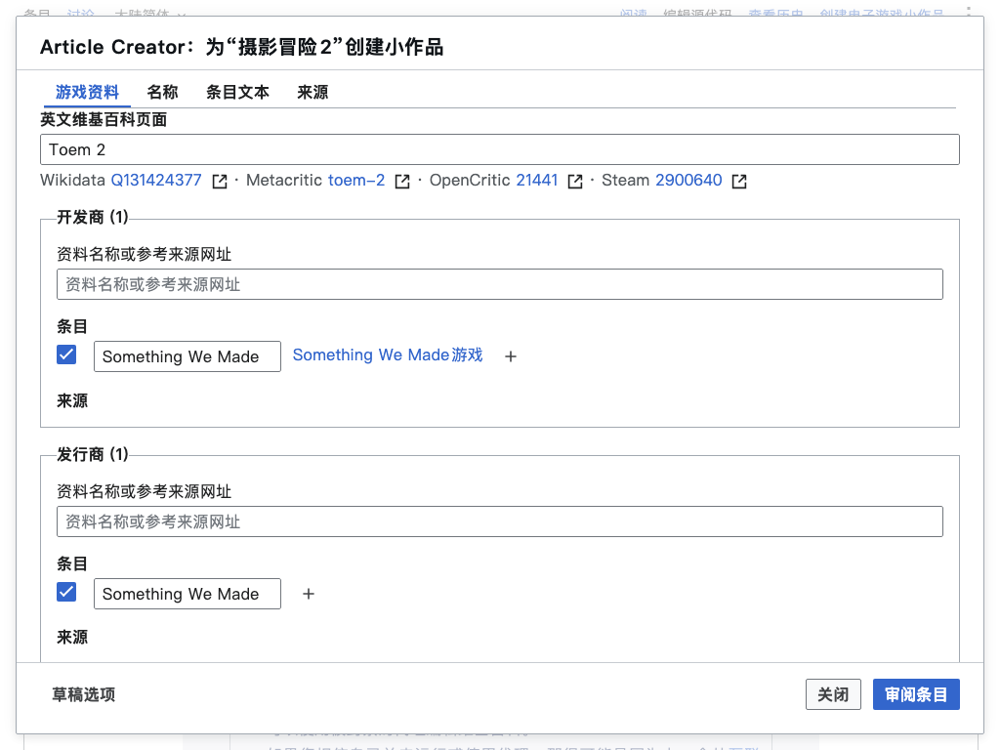

# Article Creator

Last reviewed: 2026-10-21.

Prepare Chinese Wikipedia video-game stub articles from game metadata. Review the
generated article and related operations before confirming a save.

## Features

- Import and edit game metadata, names, sources, categories, and prose.
- Recognize company, platform, genre, and year terminology with wiki evidence.
- Manage article titles, localized names, redirects, and conversion rules.
- Review wikitext, previews, edit summaries, and selected related operations.
- Restore drafts and review unfinished work before resuming it.

## Install and open

Install [vg_stub_creator.user.js](../../dist/vg_stub_creator.user.js) in a
userscript manager, or paste
[vg_stub_creator.min.js](../../dist/vg_stub_creator.min.js) into
`Special:MyPage/common.js`. The userscript supports English and Chinese Wikipedia.
Install it on both wikis when starting from an English article. Remove it by
disabling the userscript or deleting its `common.js` code.

See the [project installation guide](../../README.md#install-and-use) for shared
build and installation methods.

On English Wikipedia, select **Create Chinese Wikipedia stub** in page tools.
On Chinese Wikipedia, select **Create video game stub** on a missing article or
draft page, or from the source-edit view of an article, draft, your own user page,
or its subpages. The interface supports English, Japanese, Russian, and both
Chinese variants.

**Create Chinese Wikipedia stub** retains its Chinese Wikipedia destination and
opens it in another tab; **Create video game stub** opens the local creation form.
Both actions stay in page tools; Creator adds no bottom-right button or link.

## Use

All generated edit summaries use English in every interface language, including
article saves and follow-up edits. Page titles keep their original wording,
and manually reviewed summaries are preserved.

Enter game metadata and source URLs, then review the generated article.
Each name card has editable text, source, properties, and a collapsible **Uses**
row for page title, redirects, conversion rules, sort key, and main name. Blank
overrides follow the source name. Page-title and redirect checks distinguish
confirmed missing pages from existing or unconfirmed titles.

In Names and Article text, paste source URLs into the source input, or type a
URL and press Enter or leave the input. Sources appear as plain vertical links
with individual remove actions, and the input clears for the next URL. Pasting
multiple lines adds each URL once.

Metadata rows show editable wikitext and related category/template chips. Select
which suggestions to include and inspect their sources. Failed checks do not
confirm that a page is missing. Before saving, review the article, exact target
titles, edit summaries, and every selected related operation.

Saving can create or modify live wiki pages using your logged-in account.
If an operation stops, review its recorded progress before resuming; uncertain
writes are not automatically repeated. The [workflow guide](workflow.md)
explains review, confirmation, and recovery in detail.

This illustrative draft runs on the actual Chinese Wikipedia source view of
[信賴鈴音 ～蕭邦之夢～, revision 94743103][capture-source], by
[Chinese Wikipedia contributors][capture-history], under [CC BY-SA 4.0][capture-license].
[Capture details](images/README.md) distinguish the supplied Toem 2 input from
actual Wikipedia page checks and record English and both Chinese interface variants.

## Reference

- [Project maintenance](../maintenance.md) for status, contact, dependencies,
  browser data, recovery, and handoff.
- [Workflow](workflow.md) and [configuration](configuration.md).
- [Terminology data maintenance](terminology-database.md).
- [Architecture](architecture.md) and [interface details](../ui-guidelines.md).
- [Development](../development.md) and [documentation](../documentation.md).
- [License](../../LICENSE) and [third-party notices](../../THIRD-PARTY-NOTICES.md).

[capture-source]: https://zh.wikipedia.org/w/index.php?title=%E4%BF%A1%E8%B3%B4%E9%88%B4%E9%9F%B3_%EF%BD%9E%E8%95%AD%E9%82%A6%E4%B9%8B%E5%A4%A2%EF%BD%9E&oldid=94743103
[capture-history]: https://zh.wikipedia.org/w/index.php?title=%E4%BF%A1%E8%B3%B4%E9%88%B4%E9%9F%B3_%EF%BD%9E%E8%95%AD%E9%82%A6%E4%B9%8B%E5%A4%A2%EF%BD%9E&action=history
[capture-license]: https://creativecommons.org/licenses/by-sa/4.0/
