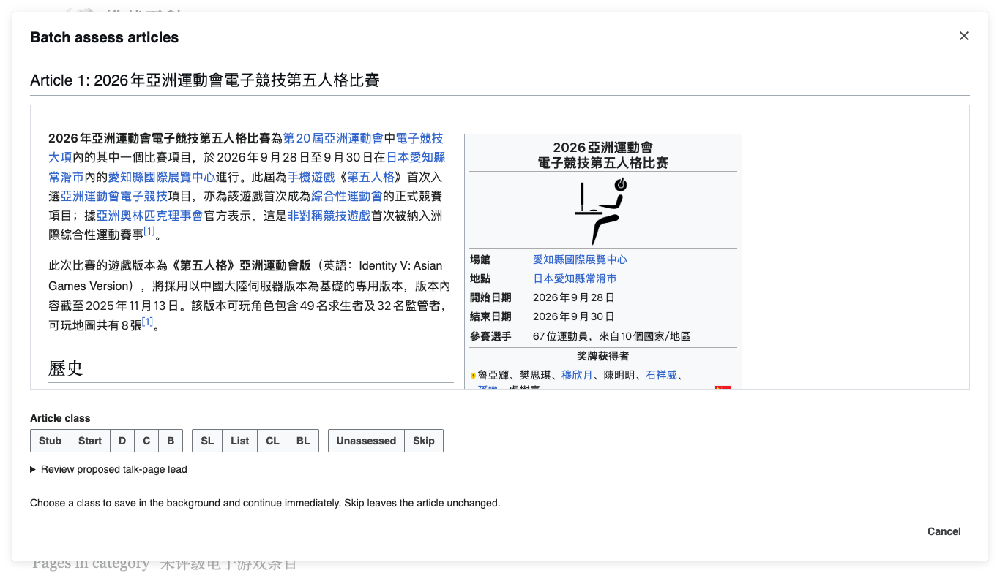

# Article Assessor

Last reviewed: 2026-11-09.

Assess video-game articles on Chinese Wikipedia and maintain the WikiProject's
new-page records. The tool saves reviewed edits using your logged-in wiki account.

## Features

- Set class, importance, task forces, and maintenance flags from existing banners.
- Review proposed source, highlighted changes, and separate edit summaries.
- Stage drafts across browser tabs and submit several assessments together.
- Assess category articles with previews and recover failed saves.
- Review and archive dated new-page records into annual archive pages.

## Install and open

Install [wpvg_assessor.user.js](../../dist/wpvg_assessor.user.js) in a userscript
manager, or paste [wpvg_assessor.min.js](../../dist/wpvg_assessor.min.js) into your
Chinese Wikipedia `Special:MyPage/common.js`. Reload and choose **Article Assessor**
from page tools on an article or talk page. Disable the userscript or remove its
`common.js` code to uninstall it. Labels support English, both Chinese variants,
Japanese, and Russian.

To open the appropriate Assessor interface directly, add `?wpvg-assessor=1` to
the page URL, or `&wpvg-assessor=1` if it already has a query string. The tool
must be installed and the page must be supported. The launch marker is removed
after the supported page loads, so reloading does not reopen the dialog. Opening
the interface does not submit an edit.

With the userscript installed, article and talk-page links in results on
[PetScan][petscan] (`petscan.toolforge.org` or `petscan.wmcloud.org`) open
the assessment interface on Chinese Wikipedia. The same behavior applies to
article links in the WikiProject's new-page list. Links retain their usual
navigation behavior, including opening in another tab. Edit, history, revision,
missing-page, and navigation links retain their usual destinations. A wiki-local
`common.js` installation supports the new-page list; PetScan requires a userscript
installation because wiki scripts do not run there.

Page tools show **Batch assess articles** on the unassessed category or
**Archive tool** on the new-page list.

See the [project installation guide](../../README.md#install-and-use) for shared
build and installation methods.

## Use

Choose class and importance from the compact, wrapping radio groups. The final
class row places **Custom** beside a short textbox. Choose its radio to enable
the textbox; switching to a preset keeps the custom value available.
Assessment choices, talk-page review, and registration follow one full-width
reading order on every screen size.

Set the assessment, review proposed talk-page source and summaries, then choose
**Submit**. Registration appears only for eligible new articles. Turn on **Stage**
to keep the reviewed draft across navigation; later changes synchronize with that
staged draft. Turn it off to remove the current page from the queue while retaining
the form. Opening a new assessment leaves Stage off. **Collapse** keeps the current
draft in a compact panel while you read the article; **Expand** restores its review.

When drafts are queued, **Submit (+N)** opens **Confirm batch save**. Review each
page's changes and the combined registration, edit queued assessments with the
pencil action, and check the pages to include. Unchecked staged pages remain queued.
The remove action takes a page out of the queue. **Back** returns to the current
form with its source and custom summaries intact. **Confirm and save** submits only
the selected reviewed pages, with at least six seconds between actual edit requests.
Progress shows completed edits and the next pending page. A single unqueued page
still saves through **Submit**.

Generated edit summaries use English in every interface language. Batch
registration combines page links and UTC creation dates in one summary, such as
`Register [[First game]] (Sept 6), [[Second game]] (Sept 6) and [[Third game]] (Sept 7)`.
The script marker appears once. If the full summary exceeds 255 UTF-8 bytes,
article links come first, followed by counts such as `2 files and 1 category`.
Only the first article links that fit are listed; remaining articles are counted.
The byte budget includes dates and the script marker; common CJK characters use
three bytes each. You can edit each page's summary before staging or submitting
it; custom registration summaries are retained even if they exceed that budget.

On the unassessed video-game category, choose **Batch assess articles** and read
the article preview. **Choosing a class saves that assessment immediately and
advances to the next article.** **Skip** advances without saving. **Cancel** closes
the interface while pending saves finish. Failed reviews remain in the same tab
for explicit retry until reload.

On `WikiProject:电子游戏/新进条目`, open **Archive tool**, review the retained
list and annual destinations, then choose **Archive**. It moves whole months,
keeping the current UTC month and the previous month in the list. After a stopped
save, choose **Reload preview** and review the current state before continuing.

The retained image shows the live category workflow on
[Category:未评级电子游戏条目, revision 80842948](https://zh.wikipedia.org/w/index.php?title=Category%3A%E6%9C%AA%E8%AF%84%E7%BA%A7%E7%94%B5%E5%AD%90%E6%B8%B8%E6%88%8F%E6%9D%A1%E7%9B%AE&oldid=80842948),
by [Chinese Wikipedia contributors](https://zh.wikipedia.org/w/index.php?title=Category%3A%E6%9C%AA%E8%AF%84%E7%BA%A7%E7%94%B5%E5%AD%90%E6%B8%B8%E6%88%8F%E6%9D%A1%E7%9B%AE&action=history),
under [CC BY-SA 4.0](https://creativecommons.org/licenses/by-sa/4.0/).
The [image inventory](images/README.md) records preview and image provenance.
The project's CC0 dedication covers its own interface; article and talk-page
text retain their stated terms.

## Reference

- [Project maintenance](../maintenance.md) for status, contact, dependencies,
  browser data, recovery, and handoff.
- [Review workflow](review-workflow.md): eligibility, staging,
  category saves, archiving, and conflict recovery.
- [Architecture](architecture.md) and [interface details](../ui-guidelines.md).
- [Development](../development.md) and [documentation](../documentation.md).
- [License](../../LICENSE) and [third-party notices](../../THIRD-PARTY-NOTICES.md).

[petscan]: https://petscan.toolforge.org/
